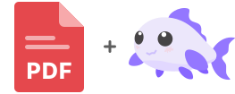

<div align="center">
	

# PDF for Coi

[](LICENSE)
[](http://makeapullrequest.com)

Write PDF files from drawing commands in [Coi](https://github.com/coi/coi).

</div>

This package gives you:

- `Pdf::Writer` for pages of paths, pictures and text, saved as a PDF file
- Embedded TrueType fonts: only the glyphs you use, and the text stays searchable and copyable
- Font fallback chains, so a Latin file and an extended one act as one font
- Transparency for strokes, fills and pictures

## Install

Install from the Coi registry:

```bash
coi add @coi/pdf
```

Then import it:

```coi
import "@coi/pdf";
```

## Quick Start

```coi
import "@coi/pdf";

component Export {
	mut Pdf::Writer pdf = Pdf::Writer(&written);

	def save() : void {
		pdf.begin();
		pdf.addPage(595.0, 842.0);
		pdf.setFillColor(31, 41, 51, 1.0);
		pdf.drawText("Hello from Coi", 72.0, 100.0, 24.0);
		pdf.finish();
	}

	def written(uint8[] data, string error) : void {
		if (!error.isEmpty()) {
			System.error(error);
			return;
		}
		Files.save("hello.pdf", "application/pdf", data);
	}
}
```

Coordinates are in points (1/72 inch), with the origin at the top left and y going down. A4 is
595 × 842, US Letter 612 × 792.

## Writer API

Create a writer with the function that gets the finished file:

```coi
mut Pdf::Writer pdf = Pdf::Writer(&written);   // written(uint8[] data, string error)
```

### Document

- `begin()` starts a new document (anything drawn before is dropped)
- `addPage(width, height)`
- `finish()` fetches the fonts, compresses the streams and calls `written`

### Paths

- `moveTo(x, y)`
- `lineTo(x, y)`
- `quadTo(cx, cy, x, y)`
- `curveTo(c1x, c1y, c2x, c2y, x, y)`
- `rect(x, y, width, height)`
- `closePath()`
- `stroke()`
- `fill()`

### Colors and lines

- `setStrokeColor(r, g, b, alpha)`
- `setFillColor(r, g, b, alpha)`
- `setLineWidth(width)`
- `setLineCap(Pdf::Cap::Round)` (`Butt`, `Round`, `Square`)
- `setLineJoin(Pdf::Join::Round)` (`Miter`, `Round`, `Bevel`)
- `save()`
- `restore()`

Colors are 0–255, alpha 0–1.

### Pictures

- `drawImage(source, x, y, width, height)`

`source` is an `Image` or a `Canvas`. Its pixels are copied right away, so it can change or be
freed afterwards. Opaque pictures are stored as JPEG, the rest keep their transparency. The same
`Image` drawn twice is stored once.

### Text

- `addFont(name, url)`
- `setFont(name)`
- `setTextSlant(slant)`
- `drawText(text, x, y, size)`

`y` is the baseline. `setTextSlant` leans the text drawn after it to the right: each point of a
letter moves over by `slant` times its height above the baseline. `0.25` is the slant browsers give a font that has no
italic face, so text set in italic on a web page comes out the same in the PDF; `0` is upright again. Without a font the text is Helvetica, which every PDF reader has but which
covers Latin-1 only (other characters become `?`).

`addFont` takes a TrueType file (`.ttf`). Several files under one name make a chain: each
character is drawn from the first file that has it. The files are fetched in `finish()` and
embedded with only the glyphs used. A file that can't be fetched falls back to Helvetica.

## Examples

### 1) Shapes and transparency

```coi
pdf.begin();
pdf.addPage(595.0, 842.0);

// a filled card
pdf.setFillColor(251, 243, 219, 1.0);
pdf.rect(72.0, 72.0, 451.0, 120.0);
pdf.fill();

// a highlighter stroke, half transparent
pdf.setStrokeColor(255, 214, 10, 0.5);
pdf.setLineWidth(14.0);
pdf.setLineCap(Pdf::Cap::Round);
pdf.moveTo(90.0, 240.0);
pdf.quadTo(300.0, 220.0, 500.0, 240.0);
pdf.stroke();

pdf.finish();
```

### 2) Fonts with a fallback

```coi
pdf.begin();
pdf.addFont("body", "/fonts/inter-latin-400.ttf");
pdf.addFont("body", "/fonts/inter-latin-ext-400.ttf");
pdf.addFont("bold", "/fonts/inter-latin-700.ttf");

pdf.addPage(595.0, 842.0);
pdf.setFillColor(31, 41, 51, 1.0);

pdf.setFont("bold");
pdf.drawText("Field trip to Łódź", 72.0, 100.0, 24.0);

pdf.setFont("body");
pdf.drawText("Tickets: 12 € — “bring a lunch”", 72.0, 130.0, 12.0);

pdf.finish();
```

Static fonts work best: give each weight its own file. A variable font is used at its default
instance.

### 3) Pictures

```coi
component Report {
	mut Pdf::Writer pdf = Pdf::Writer(&written);
	mut Image photo;
	mut Canvas chart;

	mount {
		photo = Image.load("/images/team.jpg");
		chart = Canvas.createCanvas("chart", 400.0, 200.0);
	}

	def save() : void {
		pdf.begin();
		pdf.addPage(595.0, 842.0);
		pdf.drawImage(photo, 72.0, 72.0, 200.0, 133.0);
		pdf.drawImage(chart, 72.0, 240.0, 400.0, 200.0);
		pdf.finish();
	}

	def written(uint8[] data, string error) : void {
		if (error.isEmpty()) Files.save("report.pdf", "application/pdf", data);
	}
}
```

## Limits

- No kerning or shaping: scripts that need ligatures to read (Arabic, Indic scripts) won't come out right.
- TrueType outlines only (`glyf`): not OpenType/CFF fonts, not woff/woff2.
- Needs `CompressionStream` in the browser (Chrome 80, Firefox 113, Safari 16.4).

## Development

With your Coi app set up in the same workspace, build as usual:

```bash
coi build   or   coi dev
```

## License

MIT License (see [LICENSE](LICENSE)).
